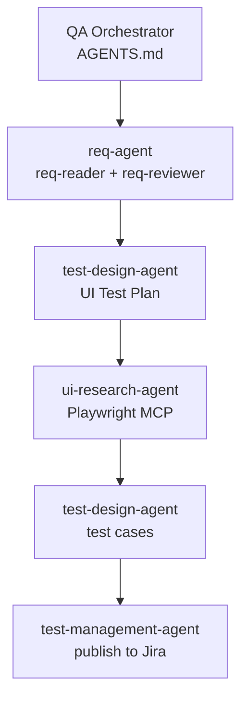

# multiagent-req-to-test

An MVP multi-agent system for preparing detailed test cases from requirements and UI research of a web application. The main orchestration agent coordinates requirement retrieval and review, test design, UI research, and publication of approved cases to Jira.

## Workflow Overview



The full route is not a rigid chain: each specialist agent can be called independently with ready input artifacts. The orchestrator manages dependencies, user approvals, and transitions between stages.

## Agents and Skills

Agent configurations are in `.codex/agents/*.toml`; their detailed instructions are in the matching `instructions.md` folders.

| Agent | Purpose | Skills |
|---|---|---|
| `req-agent` | Retrieve and review requirements | `req-reader`, `req-reviewer` |
| `test-design-agent` | Create a UI Test Plan and detailed cases | `ui-test-plan-creator`, `test-cases-creator` |
| `ui-research-agent` | Research the UI using Playwright MCP | `ui-research` |
| `test-management-agent` | Publish cases to Jira | `jira-test-cases-publisher` |

## Requirements

- Codex with support for project-level `.codex/config.toml` and custom agents;
- Node.js 22.14 or later, with `npm` and `npx` on PATH;
- access to Jira/Confluence and the test application, only for the relevant stages;
- Chromium, only for UI research.

The documented setup is designed for Windows and PowerShell: the example configuration uses `npx.cmd`, and setup and run commands are written for PowerShell. macOS and Linux may require adjustments to MCP launch commands, paths, and browser installation steps; support on those operating systems is not guaranteed.

## Quick Start with Codex CLI

This is the complete setup for a user who has just cloned the repository.

### 1. Install prerequisites

Check versions in PowerShell:

```powershell
codex --version
node --version
npm --version
npx --version
```

If `codex` is not found, install Codex CLI using the [official OpenAI instructions](https://developers.openai.com/codex/cli/).

### 2. Open the project root

```powershell
git clone <repository-url>
Set-Location .\multiagent-req-to-test
```

Run Codex from the directory containing `AGENTS.md` and `.codex/`; otherwise, relative MCP paths may resolve incorrectly.

### 3. Install read MCP dependencies

```powershell
npm ci --prefix .codex/tools
npm run check --prefix .codex/tools
```

`check` builds both read-only MCP servers, runs their unit tests, and checks masking.

### 4. Create local configuration

```powershell
Copy-Item .codex/config.toml.example .codex/config.toml
```

In `.codex/config.toml`, replace **all** `${pathToYourFolder}` placeholders with the absolute path to the clone root, without a trailing `/`, for example `D:/Projects/multiagent-req-to-test`. This is a placeholder, not an environment variable. Use `/` in Windows TOML paths.

Check that `cwd` for each read MCP points to its matching `.codex/tools/*-read-mcp` directory, while Jira write MCP and Playwright point to the project root. The local `config.toml` is ignored by Git; only the template, without personal paths or secrets, is committed.

The configuration connects:

- `jira-read-mcp` with `get_masked_issue`;
- `confluence-read-mcp` with `get_masked_page`;
- the official Playwright MCP;
- `jira-write-mcp` with `jira_get` and `jira_post`.

### 5. Configure access

Create local `.env` files from the templates:

```powershell
Copy-Item .codex/tools/jira-read-mcp/.env.example .codex/tools/jira-read-mcp/.env
Copy-Item .codex/tools/confluence-read-mcp/.env.example .codex/tools/confluence-read-mcp/.env
Copy-Item .env.example .env
```

Fill in `.codex/tools/jira-read-mcp/.env` or `.codex/tools/confluence-read-mcp/.env` with access to the relevant requirements source. Put Jira publishing credentials in the root `.env`. Do not paste tokens into the README, commits, or chat with the agent.

### 6. Install Chromium for Playwright

If Chromium is not installed yet, run this from the project root:

```powershell
$env:PLAYWRIGHT_BROWSERS_PATH = "$(Get-Location)/artifacts/playwright-browsers"
npx playwright install chromium
```

Playwright MCP runs with a visible browser: `--headless` is not set in the configuration. The browser and profile are stored under `artifacts/`, not in user directories on drive C.

### 7. Restart Codex and check MCP

After changing the configuration, fully restart Codex and start a new session from the project root:

```powershell
codex mcp list
codex
```

For UI research, verify that `browser_navigate` and `browser_snapshot` are available in the current session. A server appearing in `mcp list` does not guarantee its tools are registered. If the MCP server is listed but its tools are missing, check `cwd` and paths in the local `config.toml`, then restart Codex.

### 8. Run the workflow

In the open session, send a prompt such as:

```text
Run the full QA workflow for requirement PROJ-123.
```

For Confluence, provide a page ID or link. To run one stage only:

```text
Ask req-agent to retrieve and review requirement PROJ-123.
```

For UI research, the agent will separately ask for a clean HTTPS URL to the test application, without credentials, query, or fragment. If needed, the user signs in and completes MFA manually in the open browser, then tells the agent when done; do not close the browser before then.

## Approvals During the Workflow

The agent pauses before decisions that require approval:

- when requirements have findings: continue with open questions, get LLM suggestions, or answer them yourself;
- approve the UI Test Plan and provide the application URL;
- separately approve creation and later deletion of synthetic test data;
- approve UI research results; after approval, the agent closes the browser;
- approve the test cases;
- provide the Jira project, review the full `jira-task-preview.md`, and approve the full batch before publication.

Approving test cases does not by itself authorize Jira POST requests. Full-workflow results are saved in `artifacts/<run-id>/`; keep this directory if you want to continue later.

## Access and Permissions

- For requirement retrieval, configure separate read-only API credentials in `.codex/tools/jira-read-mcp/.env` and/or `.codex/tools/confluence-read-mcp/.env`. They should have only the read permissions needed for the relevant projects or pages.
- For Jira publishing, set credentials in the root `.env`. The account needs permission to view the project and create issues in it. The wrapper exposes only Jira MCP tools `jira_get` and `jira_post`; update/delete tools are not connected.
- In the template, `approval_policy = "never"` applies to shell-command approval prompts, while `sandbox_mode = "workspace-write"` sets file access boundaries. Jira MCP has a separate `default_tools_approval_mode = "approve"`; Codex may ask for approval for `jira_get` and `jira_post` calls. This is a separate permission layer: approving the full `jira-task-preview.md` is required by the workflow before publication and does not turn off MCP prompts.
- Before using a production Jira project, check that tokens are stored only in local `.env` files, have the minimum required permissions, and that the project and preview are correct. To change MCP approval behavior, edit the local `.codex/config.toml`; the Skill/MCP does not need to be rebuilt.

## Artifacts and Continuing Work

`requirements.md` contains normalized requirement text, and `requirements-review.md` contains the review, questions, and accepted assumptions. For Confluence, the original masked response is saved in `masked-source.json` as a technical source for comparison, not as a separate user-facing result.

After UI research, `ui-research-coverage.json` and `ui-observations/` are created; `ui-context.json` is also created if an initial snapshot was obtained. Overall research status is `complete`, `partial`, or `blocked`. Each plan item is marked `observed`, `partial`, `blocked`, or `not_researched`. `observed` means only that something was observed, not that the requirement works correctly. An incomplete UI context is noted under `Clarifications` in test cases; it does not prevent case creation or automatically change the automation recommendation.

The UI agent calls `save-ui-observation.ts` after every Playwright MCP response: the script converts the temporary response JSON into a validated file under `ui-observations/<NNN>-<slug>.json`. The agent then creates `ui-research-coverage.json` and calls `build-ui-context.ts`. This script reads observations, `ui-test-plan.md`, and coverage, validates their links, and creates `ui-context.json`. If the overall status is `blocked`, the second script does not run and UI context is not created.

In `test-cases.md`, steps and results are stored inside a Markdown table, so line breaks use `<br>`. For Jira, the publisher converts the content to ADF: subsection headings are bold, and Steps and Expected Result are separate numbered lists. `Priority` is sent as Jira's system field, and `Test Automation` as a label; neither is repeated in Description.

The UI report estimates UI coverage as the requirements with `observed` UI evidence divided by the requirements included in research. The final summary separately reports requirements coverage by test cases: requirements with at least one `TC-NNN` divided by all standalone requirements. For both metrics, the numerator and denominator are shown; these are artifact-based estimates, not automated checks.

To continue, specify the operation and artifact directory. For example: “Continue creating test cases from the requirements, review, and UI context in `artifacts/example-run/`.” The agent checks the required inputs and does not retrieve already-saved requirements again. Results are not overwritten without an explicit request.

## Jira Publishing

Publication creates one Jira issue of type `Task` for each `TC-NNN`. If that type is not available in the selected project, the agent asks which available type to use instead.

Duplicates are checked using Summary `[TC-NNN] <Name>`:

1. exact `TC-NNN` and exact Summary — the issue already exists;
2. same `TC-NNN` but a different Summary — possible duplicate;
3. no `TC-NNN`, but a clearly similar Summary — possible duplicate;
4. otherwise, create a new issue.

For each case, Priority is matched by name to an available Jira priority (`Highest`, `High`, `Medium`, `Low`, `Lowest`) and sent as a system field. Automation uses label `automation-yes` for `Test Automation = Yes` and `automation-no` for `No`.

Before writing, the agent creates `jira-task-preview.md` with one row per case, shows it to the user, and requests one approval for the full preview. Jira POST is not allowed before approval. After a confirmed failed POST, the agent checks for a duplicate and may retry publication up to two times. An unknown POST outcome is not retried automatically; it requires a manual check. `external-test-cases-map.json` stores confirmed Jira keys and statuses so work can safely continue.

## Safety and Boundaries

- Read MCP servers return only masked representations of requirements.
- Do not give agents `.env` files, tokens, cookies, storage state, authorization headers, or raw logs.
- Masking reduces risk but does not guarantee that all sensitive information is removed.
- UI context and responses from Jira write MCP do not go through read masking.
- The QA workflow does not run `commit`, `push`, `pull`, `fetch`, or `reset`.

`.env`, `.codex/config.toml`, and `artifacts/` are ignored by Git. This does not remove secrets that are already tracked or present in Git history; check the Git contents separately before publishing the repository.

## Local Checks

Run these commands from the project root in PowerShell:

```powershell
npm run check --prefix .codex/tools
$qaTests = Get-ChildItem .codex/scripts,.codex/skills -Recurse -File | Where-Object { $_.Name -match '\.test\.(ts|mjs)$' } | ForEach-Object { $_.FullName }
node --experimental-strip-types --test $qaTests
git diff --check
```

Local tests check normalization, masking, artifact contracts, and the Windows launcher, but do not prove external MCP authentication or behavior. Before using it for real work, run a trial workflow in a test environment.

## Eval Cases and Security Checks

`evals/dataset/golden-dataset.json` contains scenarios for automated evaluation. `evals/eval-runner.ts` runs the QA agent for each scenario, collects the response and artifacts, and `evals/evaluator.ts` scores them against expected properties and forbidden behavior. Running the evaluations requires Codex CLI, a configured project, and all scenario input files:

The evaluation flow is shown in the [English evaluation workflow diagram](auto-eval-cases-structure-en.svg).

```powershell
node --experimental-strip-types evals/eval-runner.ts
```

The `evals/dataset/inputs/` and `evals/dataset/references/` directories are excluded from Git and are not created by the runner. Prepare them locally before running evaluations: `inputs/` contains test input files referenced by scenarios; `references/` contains verified reference artifacts. These can be prepared from successful runs, then reviewed and saved under the matching `EVC-NNN` directory. Without these local files, scenarios that reference them will lack some of their inputs or evidence for evaluation.

Scenario `EVC-010` includes placeholders for values that look sensitive. Before running it, manually replace them with fake test values. Do not use real addresses, passwords, tokens, or other active credentials.

`SEC.md` contains manual adversarial test cases for checking agent safeguards. These scenarios are meant to be run manually; they are not automated and are not run by `eval-runner.ts`.

Detailed coordination rules are in [AGENTS.md](AGENTS.md); agent and Skill instructions are in `.codex/agents/` and `.codex/skills/`.
